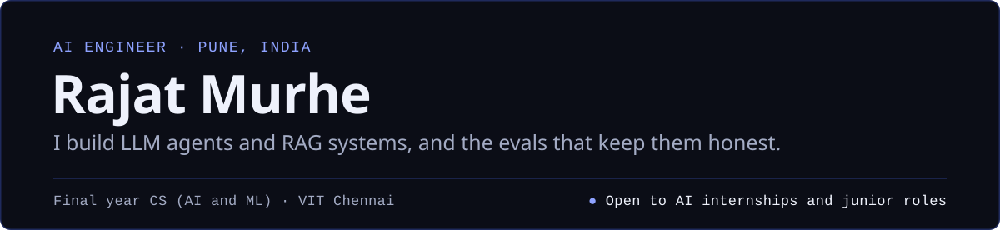
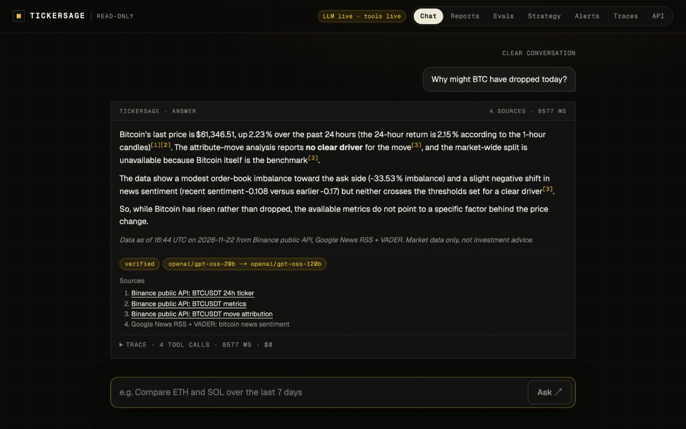
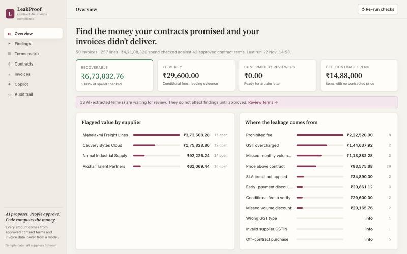

<p>
<a href="https://drive.google.com/file/d/1hkfZVrAmDvxD9OvDVLowiNIKv6A7m7Fz/view?usp=sharing"></a>
<a href="https://linkedin.com/in/rajat-murhe"></a>
<a href="mailto:rajatmurhe1@gmail.com"></a>
</p>

## About

```yaml
name:        Rajat Murhe
based_in:    Pune, India
studying:    BTech Computer Science (AI and Machine Learning), VIT Chennai, graduating Sep 2027
experience:  4 internships across AI engineering, applied ML and AI product work
building:    LLM agents, RAG systems, eval harnesses, FastAPI backends, Next.js frontends
daily_tools: Claude Code, Cursor, Codex
looking_for: AI, GenAI and agentic AI internships and junior roles (India or remote)
```

I care about AI systems that are right, safe and fast at the same time. Most of my projects ship with an eval set, a red team set and CI that blocks regressions, because a demo that works once is not a product.

## Selected work

<table>
<tr>
<td width="50%" valign="top">

<a href="https://github.com/rajatmurhe/tickersage"></a>

### [TickerSage](https://github.com/rajatmurhe/tickersage)
Read only crypto market research agent.

- 8 read only tools, and a **number verifier** checks every figure against the tool data before an answer goes out
- Attacks getting through cut from **72.8% to 1.9%**, with 932 saved attacks rerun in CI
- Slowest 5% latency cut from **4.5 s to 1.7 s** at the same 78.8% pass rate on a blind held out set

`Python` `FastAPI` `LangGraph` `MCP` `Next.js` `Groq`

</td>
<td width="50%" valign="top">

<a href="https://github.com/rajatmurhe/leakproof"></a>

### [LeakProof](https://github.com/rajatmurhe/leakproof)
Checks supplier invoices against what the contract actually says.

- An LLM proposes contract terms, a person approves them, and a **C# rules engine** works out every rupee
- Checking the model's output lifted extraction precision from 67.8% to **97.5%** on a 3B local model
- 8 rules including GST rate, tax type and GSTIN checks, covered by **61 xUnit tests**

`C#` `.NET 10` `ASP.NET Core` `React` `FastAPI` `Ollama`

</td>
</tr>
</table>

<table>
<tr>
<td width="50%" valign="top">

### [ClinicVoice AI](https://github.com/rajatmurhe/clinicvoice-ai)
Voice first clinic receptionist in English, Hindi and Marathi.

- Six workflow agents, and only the FAQ agent calls an LLM (Groq with **Gemini failover**)
- Blocks dosage, diagnosis and prompt injection requests; the **red team set** runs in CI

`Python` `FastAPI` `Node.js` `Groq` `Whisper`

</td>
<td width="50%" valign="top">

### [ContractIQ](https://github.com/rajatmurhe/contractiq)
AI contract review assistant. [Live demo](https://contractiq-frontend-2e3u.onrender.com/)

- Every answer shows the **exact source quote** it came from, checked against the contract text
- Synthetic evals for missing evidence, conflicting clauses and prompt injection

`Next.js` `TypeScript` `FastAPI` `SQLite` `Render`

</td>
</tr>
<tr>
<td width="50%" valign="top">

### [Atlas](https://github.com/rajatmurhe/atlas-commercial-intelligence)
AI powered commercial intelligence workbench.

- LangGraph analytics agent over a **PostgreSQL star schema** of 24,576 synthetic sales records
- Forecast MAPE of **1.25%** against 4.70% for a seasonal naive baseline

`Python` `LangGraph` `PostgreSQL` `Forecasting`

</td>
<td width="50%" valign="top">

### [FieldProof AI](https://github.com/rajatmurhe/fieldproof-ai)
Multi tenant video QA platform for field service.

- Gemini checks job videos against a checklist and returns PASS, FAIL or NOT_VISIBLE with **evidence timestamps**
- PostgreSQL job queue with retries, stale job recovery and human review

`Python` `FastAPI` `Next.js` `PostgreSQL` `Gemini`

</td>
</tr>
</table>

<details>
<summary><b>More projects</b></summary>
<br>

| Project | What it is | Links |
|---|---|---|
| Veritas | Finds copied, paraphrased, read aloud and AI written work across PDF, DOCX and MP4, with the exact evidence for every flag | [GitHub](https://github.com/rajatmurhe/Multimodal-Submission-Integrity-Plagiarism-Detection-Engine) |
| SentinelAI | Adaptive insider threat detection research on the CERT dataset | [Live](https://sentinel-ai-czmu.onrender.com) · [GitHub](https://github.com/rajatmurhe/Sentinel-AI) |
| Pulse Outreach | Job application and multi resume routing platform | [GitHub](https://github.com/rajatmurhe/Job-Outreach-Platform) |
| AI Job Assistant | Resume and job matching with evidence for every skill | [GitHub](https://github.com/rajatmurhe/ai-job-assistant) |
| Market Signal | Prediction market terminal built on news sentiment | [Live](https://market-signal-kh9r.onrender.com) · [GitHub](https://github.com/rajatmurhe/Market-Signal) |
| NeuroAI | Explainable clinical diagnostic platform | [Live](https://neuroai-diagnostic-platform.onrender.com) · [GitHub](https://github.com/rajatmurhe/NeuroAI-Diagnostic-Platform) |
| RAG Intelligence | Full stack chat with PDFs platform | [Live](https://ragpdf-frontend.onrender.com) · [GitHub](https://github.com/rajatmurhe/RAGPDF) |
| CreditX | Credit risk classification | [Live](https://credix.streamlit.app) · [GitHub](https://github.com/rajatmurhe/CrediX-Explainable-Credit-Intelligence) |

</details>

## Experience

| Role | Company | When |
|---|---|---|
| AI Engineer Intern | AIQuest | Nov 2026 to Present |
| Applied AI and Software Engineering Intern | DCS AI Technologies | Sep 2026 to Present |
| AI/ML Intern | Linkific (Remote) | Jun 2026 to Aug 2026 |
| AI Intern | Rungta Ventures AI | Jan 2026 to May 2026 |

- **AIQuest:** Building production AI features with Python, FastAPI and AWS.
- **DCS AI Technologies:** Built and tested connectors for an AI integration platform, tested multimodal AI workflows and credit consumption, and wrote an AI model routing report.
- **Linkific:** Secure enterprise AI assistant backend with FastAPI, RAG on PostgreSQL with pgvector, role based access control and Groq.
- **Rungta Ventures AI:** Worked on the Buddyly and MyCA platforms in a team of about ten, with NLTK and spaCy document validation and semantic search. Also built a CCTV intrusion detection system with PyTorch detectors, ONNX packaging and multi camera alerts.

## Skills

| Area | Tools |
|---|---|
| AI and agents | LangGraph, LangChain, MCP, OpenAI, Claude, Gemini, Groq, Hugging Face, PyTorch, scikit-learn |
| Backend and data | Python, FastAPI, Node.js, C#, .NET, PostgreSQL, pgvector, Redis, MongoDB |
| Frontend and DevOps | TypeScript, React, Next.js, Docker, GitHub Actions, AWS, GCP, Render |

## Certifications and awards

| Award or certification | From |
|---|---|
| First Prize, AGRHINOVA Hackathon (April 2026) | VIT Chennai |
| Avery Dennison Scholarship | Avery Dennison |
| Professional Machine Learning Engineer | Google Cloud |
| Azure Developer Associate (AZ-204) | Microsoft |
| Azure Fundamentals (AZ-900) | Microsoft |
| ML Operations Engineer Associate | Microsoft |
| Cloud Practitioner Essentials (course) | AWS |
| Advanced Generative AI | IBM |
